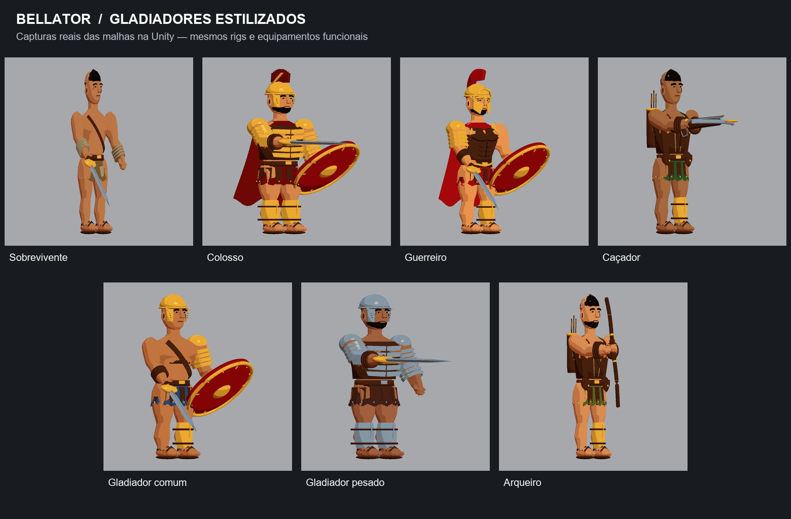

# Bellator — reformulação dos gladiadores

Atualização de 12/11/2026, Unity 6000.3.26f1 e URP 17.3.0. As mudanças estão aplicadas nos assets usados pelo jogo. A direção visual segue o guerreiro ilustrado fornecido: metal dourado, tecido vermelho, couro marrom, anatomia simplificada e sombras em faixas.

## Personagens modificados

| Personagem | Resultado visual |
|---|---|
| Sobrevivente | Corpo magro reconstruído, transições contínuas nos ombros, braços e pernas; faixas, remendo e sandálias legíveis; paleta terrosa. |
| Colosso | Corpo robusto, couraça segmentada sobre couro, capa vinho, crista longitudinal, ombreiras, proteção dos braços e duas grevas. |
| Guerreiro | Couraça de couro com volumes peitorais e abdominais, capacete com crista e proteção nasal, placas de bochecha com abertura para os olhos, capa vermelha e acabamento dourado. |
| Caçador | Corpo leve, colete ajustado, manto curto verde, bolsas, aljava e besta; pesos corrigidos para que as coxas não acompanhem os braços. |
| Gladiador comum | Corpo reconstruído, capacete aberto, proteção assimétrica, tecido azul e bronze. |
| Gladiador pesado | Corpo largo, couraça sobre couro, placas de ferro frio, capacete, proteção segmentada e duas grevas. |
| Arqueiro | Corpo reconstruído, couro e oliva, aljava, bolsas, cabelo preso e arco. |

Os rostos preservam os volumes geométricos anteriores, com novo acabamento toon. O Guerreiro recebe um novo conjunto de proteção facial. Os personagens mantêm os nomes, armas exclusivas e habilidades existentes.

## Malhas, materiais e equipamentos

O corpo passou a usar uma superfície implícita indexada, gerada no editor e gravada como malha da Unity. Tronco, ombros e membros têm transições contínuas; cabeça, mãos, pés, roupas e armaduras completam o mesmo renderer combinado. As malhas não são geradas durante a partida.

Foram regravados 22 assets de personagem: dois LODs para as variantes de seleção e gameplay das quatro classes, mais dois LODs para cada inimigo. Outros seis assets Legacy antigos de inimigos foram preservados. Cinco malhas de armas foram regravadas com normais ajustadas. GUIDs dos assets existentes foram mantidos.

O escudo recebeu uma face vermelha abaulada, aro e detalhes dourados. Gládio, espada pesada, arco e besta receberam o novo acabamento e correções de normais; suas estruturas funcionais e encaixes permanecem iguais. Sandálias, braçadeiras e grevas foram ajustadas ao novo volume corporal.

Há 21 materiais compartilhados em `Assets/Game/Art/Gladiators/Materials`: sete pares de pele/tecido, couro, bronze, ferro, cabelo, linho cru, madeira e o novo `ShieldLacquer`. Os materiais existentes mantêm seus GUIDs. As texturas antigas foram preservadas; o novo shader usa cores limpas sem ruído fotográfico.

O shader `Bellator/Gladiator Toon`, em `Assets/Game/Shaders/GladiatorToon.shader`, fornece iluminação em faixas, sombras quentes, brilho metálico controlado, luzes adicionais em Forward/Forward+, fog e passes de profundidade, normais e sombra. O pipeline e seus recursos existentes foram preservados. As formas são delimitadas por contraste e iluminação, sem novo pós-processamento de contorno.

## Prefabs, rigs e compatibilidade

Foram atualizados diretamente 20 prefabs: quatro de seleção, quatro visuais animados, quatro prévias de animação, três inimigos e cinco armas. O jogador de reserva herda a arte do Guerreiro pelo prefab aninhado existente.

O rig Generic original de 13 ossos e as curvas dos Animator Controllers foram mantidos. O skinning foi reconstruído com até duas influências por vértice. Uma revisão visual identificou conexões indevidas entre punhos e coxas; a geometria e os pesos foram corrigidos, e uma verificação adicional confirma que nenhuma face de pele liga braço e perna nos dois LODs.

Os encaixes de armas, pontos de disparo, transforms existentes, scripts, colliders, NavMeshAgents, danos, alcances, stamina, habilidades, Aim Lock e movimentação permanecem preservados. A comparação verificou 188 arquivos por SHA256, 598 transforms e 78 componentes não visuais em 22 prefabs. Nas cenas, a única mudança foram duas referências de material dos escudos embutidos na seleção, para exibir o mesmo vermelho do gameplay. Os demais arquivos de cena são idênticos à cópia inicial. A interface mantém seus arquivos e suas alterações anteriores; o enquadramento automático foi testado com as novas malhas.

As capas possuem dobras e espessura modeladas e acompanham o tronco. O projeto não recebeu simulação física de tecido, rig facial ou conversão automática para Humanoid. Não foi adicionada nem removida uma implementação multiplayer; os testes realizados são locais.

## Verificação executada na Unity

| Evidência | Resultado | Cobertura |
|---|---|---|
| [BuildValidation.txt](BuildValidation.txt) | PASS | Malhas, pesos, referências, curvas e LODs |
| [GeometryAndShaderValidation.txt](GeometryAndShaderValidation.txt) | PASS | Sete perfis equipados, 28 vistas, shader e separação braço/coxa |
| [SkinningValidation.txt](SkinningValidation.txt) | PASS | 504 poses nos dois LODs: 1.008 bakes |
| [FinalPlayMode.txt](FinalPlayMode.txt) | PASS | Quatro classes na arena, controles, combate e modos |
| [SelectionPlayMode.txt](SelectionPlayMode.txt) | PASS | Quatro classes em cinco resoluções, enquadramento e navegação |
| [ArenaPlayMode.txt](ArenaPlayMode.txt) | PASS | Movimento, colisões, câmera, Aim Lock, IA e 15 inimigos |
| [CompleteMatchesPlayMode.txt](CompleteMatchesPlayMode.txt) | PASS | Cinco ondas e fuga com cada uma das quatro classes |
| [PreservationValidation.txt](PreservationValidation.txt) | PASS | Hashes, hierarquias e componentes funcionais |

Uma primeira execução da validação final de teclado falhou na aquisição por Tab. A repetição sem alteração da lógica de input, câmera ou Aim Lock passou. A falha inicial foi mantida em `PlayerFirstAttempt.txt`; ela deve ser considerada ao avaliar a estabilidade do teste automatizado de entrada. As demais verificações de Aim Lock e troca de alvo também constam dos testes da arena.

As imagens de frente, perspectiva, lateral e costas estão nos arquivos `*_Front.png`, `*_ThreeQuarter.png`, `*_Side.png` e `*_Back.png`. As capturas mostram malhas reais renderizadas pela Unity. [Comparação antes/depois](Comparacao.png).

## Geometria e desempenho

Cada personagem mantém dois LODs e um SkinnedMeshRenderer ativo, com seis slots de material. Armas usam os materiais e malhas compartilhados. Os limites de culling continuam incluindo rolamento e morte.

| Perfil | Triângulos LOD0 | Triângulos LOD1 |
|---|---:|---:|
| Sobrevivente | 34,147 | 14,412 |
| Colosso | 44,822 | 17,693 |
| Guerreiro | 45,351 | 18,236 |
| Caçador | 37,702 | 15,660 |
| Gladiador comum | 37,915 | 15,880 |
| Gladiador pesado | 41,350 | 16,385 |
| Arqueiro | 37,894 | 15,720 |

Os valores excluem as armas. O LOD1 reduz a geometria quando o personagem ocupa menos espaço na imagem. A avaliação incluiu uma amostra no editor com 15 agentes reais:

> EDITOR SAMPLE (not standalone benchmark): 15 AI; 133 frames / 4,02s; average 33,1 FPS; worst frame 112,0ms; Unity allocated 461,1 MiB; reserved 986,2 MiB.

Essa medição inclui o custo do editor e não representa uma meta de FPS de uma build final. Não foi executado um benchmark standalone nesta atualização.

## Cópia de segurança e limites

O estado anterior está em `BalanceBackups/Stylized-20261112`, incluindo modelos, materiais, prefabs, animações, cenas, scripts e configurações. `GitStatusBefore.txt` registra as alterações que já existiam. `PreservedFiles.json` contém os hashes usados na comparação.

A modelagem é paramétrica e foi produzida na Unity; não foram criados arquivos Blender ou FBX novos. O resultado estabelece um acabamento cartoon inspirado na referência. Escultura artística manual, rostos individuais mais refinados, topologia facial e deformação de tecido mais elaborada permanecem possibilidades de acabamento. Os testes de poses verificam estabilidade numérica, e a revisão visual foi usada para corrigir problemas que esses testes não identificavam.

Para gerar novamente os assets: `Bellator > Models > Rebuild gladiator artwork`. Para as vistas e a validação de separação dos membros: `Bellator > Models > Render stylized model turnarounds`. Consulte também [o guia de estilo](GuiaDeEstilo.md).
